# Supabase GitOps

A **Database-as-Code (GitOps)** and continuous database deployment setup for **Supabase PostgreSQL**.

Provides reliable bi-directional synchronization between GitHub and Supabase:
- **Deploy forward**: Preview and apply version-controlled SQL migrations with automated pre-migration safety snapshots.
- **Capture drift**: Pull visual changes made in the Supabase Dashboard back into Git migration files using shadow database verification.
- **Automated backups**: AES-256 encrypted application-schema backups (`public` schema and data) with SHA-256 integrity manifests, zero data leakage in Git, and 90-day retention.
- **Disaster recovery drills**: Automated decryption, negative failure testing, and containerized restore verification to prove backup viability.
- **Security**: Automated Row Level Security (RLS) enforcement gates and behavioral role impersonation (`anon`, `authenticated`, `service_role`) on pull requests.
- **Multi-environment promotion**: Two-stage staging to production pipeline with independent host validation and GitHub Environment protection.
- **Performance & index advisor**: Automated linting for unindexed foreign keys, missing primary keys, and schema anti-patterns.
- **Living documentation**: Auto-generated schema documentation and interactive Mermaid ER diagrams.
- **Developer experience**: Automated TypeScript type contract synchronization and ephemeral PR database preview environments.
- **Database keep-alive & health sentinel**: Automated periodic ping preventing Supabase Free Tier inactivity pauses and measuring connection latency.

> 📖 **Operator Runbooks & Demonstration Assets:**
> - [Database Baselining Runbook](docs/runbook_baselining.md) — Step-by-step existing project adoption guide.
> - [Disaster Recovery Runbook](docs/runbook_disaster_recovery.md) — Manual backup decryption and recovery drill guide.
> - [Demonstration Gallery](docs/demo.md) — Sanitized GitHub Actions job summaries and local Docker test walkthrough.

---

> [!CAUTION]
> ### KEEP THIS REPOSITORY PRIVATE (Do Not Fork Publicly)
> 1. **Encrypted Artifact Exposure**: Database backups created by `backup-database.yml` are stored as GitHub Actions artifacts. While AES-256 encrypted, **artifacts on public repositories can be downloaded by any logged-in GitHub user**.
> 2. **Schema Disclosure in Issues**: The schema drift detection workflow (`drift-alert.yml`) automatically opens GitHub Issues when database changes are detected, which **can leak your database schema, table structures, and migration history publicly**.
>
> Always click **"Use this template"** above and set repository visibility to **Private**.

> [!WARNING]
> ### RUN AGAINST A THROWAWAY OR STAGING PROJECT FIRST
> These workflows execute live database commands, including `supabase db push`. Never connect this template directly to a mission-critical production database without first verifying your migrations and deployment pipeline against a throwaway or staging Supabase project.

---

## Who This Is For / Not For

- **Who this is for**:
  - Small teams and solo devs on Supabase hosted Postgres who want version-controlled migrations in Git, automated drift detection, and verified backups.
  - Projects needing alerts when changes are made directly via the Supabase Dashboard.
  - Developers wanting automated, encrypted backups with monthly containerized restore drills.
- **Who this is not for**:
  - Teams needing out-of-the-box backup for Supabase Auth users (`auth` schema) or Storage files (`storage` schema).
  - Teams requiring multi-year immutable retention (e.g. WORM compliance locks) without custom external object store integration.
  - Non-Supabase vanilla PostgreSQL deployments that cannot adapt Supabase CLI migrations.

---

## Limitations: Backup & Recovery Scope

> [!IMPORTANT]
> **`public` Schema Only — Do Not Assume Auth or Storage Are Backed Up**
> Standard Supabase connection roles (`postgres` or connection poolers) do not possess superuser privileges to dump platform-owned schemas without triggering permission violations. Backups are strictly scoped to `--schema=public`. If you assume auth users are backed up here, **you will lose user accounts and file metadata during a disaster recovery event**.

| Boundary Dimension | Scope & Behavior | Rationale / Prerequisite |
|---|---|---|
| **Included in Backup** | `public` schema tables, data rows, sequences, foreign keys, triggers, and custom functions | Captures all core business domain data and application state without triggering privilege errors. |
| **Excluded: `auth` Schema** | GoTrue identities, encrypted passwords, sessions, refresh tokens, MFA credentials | Managed by Supabase GoTrue; requires superuser/bypassrls to dump directly. Must be exported via Supabase Management API (`/v1/projects/{ref}/users`) or admin scripts. |
| **Excluded: `storage` Schema** | Storage bucket metadata and object tables (`storage.buckets`, `storage.objects`) | Underlying binary assets reside in S3-compatible object storage. Object storage must be replicated separately (e.g. via AWS CLI or rclone). |
| **Excluded: `vault` Schema** | Encrypted secrets and KMS keys managed by `pgsodium` | Decryption keys reside in Supabase Key Management System. Master secrets must be stored in external secret managers (e.g. GitHub Secrets). |
| **Excluded: Platform Schemas** | `graphql`, `realtime`, `pg_catalog`, `information_schema`, `supabase_functions` | Ephemeral or managed system schemas recreated automatically by the Supabase platform runtime. |

> **Why `public` schema only?**
> On hosted Supabase instances (and AWS RDS / PostgreSQL-as-a-Service generally), connection strings connect via standard project roles (e.g., `postgres` or connection poolers). These roles lack superuser privileges to dump platform-owned schemas without throwing permission violations. Restricting the automated snapshot to `--schema=public` ensures reliable, clean backups without permission failures.

---

## 30-Second Quickstart

Get automated backups and GitOps running in under a minute:

1. **Use this template (Private)**: Click **"Use this template"** > **"Create a new repository"** and set repository visibility to **Private**.
2. **Add minimum secrets**: Go to **Settings > Secrets and variables > Actions > New repository secret** and add:
   - `SUPABASE_DB_URL`: Direct PostgreSQL connection string (port 5432).
   - `BACKUP_ENCRYPTION_KEY`: A strong passphrase used by GPG for AES-256 symmetric encryption.
3. **Run “Backup database” manually**: Go to **Actions > Encrypted Database Backups > Run workflow**.
4. **Everything else is optional**: Staging secrets, branch previews, and automated schedules can be enabled whenever you need them.

### Minimum Secrets Breakdown

Only **two secrets** are needed to start:

| Secret | When Needed | Description | Format / Example |
|---|---|---|---|
| `SUPABASE_DB_URL` | **Required to start** | Direct PostgreSQL connection string (production) | `postgresql://postgres.<ref>:<password>@<host>:5432/postgres` |
| `BACKUP_ENCRYPTION_KEY` | **Required to start** | Master password for AES-256 encrypted backups | `<strong-backup-passphrase>` |
| `SUPABASE_STAGING_DB_URL` | *Only for Promotion* | Independent staging database connection string | `postgresql://postgres.<ref>:<password>@<host>:5432/postgres` |
| `WEBHOOK_URL` | *Optional* | Discord or Slack webhook for notifications | `https://discord.com/api/webhooks/...` |
| `SUPABASE_ACCESS_TOKEN` | *Optional* | Supabase Management API token for cloud branching | `sbp_...` |
| `SUPABASE_PROJECT_ID` | *Optional* | Supabase project reference ID for cloud branching | `abcdefghijklmnopqrst` |

> **Note on `SUPABASE_DB_URL`**: Use the **Direct Connection** or **Session Mode Pooler** string from your Supabase Dashboard (**Project Settings > Database > Connection string**). Do not use the transaction pooler on port 6543.

---

## Default Branch: Note on `master` vs `main`

> [!NOTE]
> This repository uses **`master`** as its default branch. GitHub defaults newly created repositories to `main`.
> - If your copied repository keeps `master` as default, workflows work immediately with zero configuration.
> - If your repository uses `main`, update branch references in `.github/workflows/` (`deploy-migrations.yml`, `capture-supabase-migrations.yml`, and `generate-docs.yml`) from `master` to `main`, or rename your default branch to `master` under **Settings > Branches**.
> Support for configurable default branch names across all workflows is tracked on our [Roadmap](#roadmap).

---

## System Architecture

```mermaid
flowchart TD
    subgraph DevFlow["1. Developer & PR Validation Flow"]
        dev["Local Migration File<br/>(supabase/migrations/*.sql)"] --> pr["Pull Request"]
        pr --> lint["lint-migrations.yml<br/>(Vanilla PostgreSQL 17 Container)"]
        pr --> rls["rls-security-audit.yml<br/>(Behavioral Test: anon / auth / service)"]
        pr --> advisor["db-advisor.yml<br/>(Index & FK Performance Linter)"]
        pr --> preview["preview-database.yml<br/>(Ephemeral Preview Container / Cloud Branch)"]
    end

    subgraph DeployFlow["2. Multi-Environment Promotion & Deploy"]
        merge["Merge to master"] --> preStaging["Pre-Staging Schema Snapshot"]
        preStaging --> stagingDeploy["Deploy to Staging<br/>(SUPABASE_STAGING_DB_URL)"]
        stagingDeploy --> gate{"Required Reviewers Gate<br/>(GitHub Production Environment)"}
        gate -->|Approved| preProd["Pre-Production Backup Snapshot"]
        preProd --> prodDeploy["Deploy to Production<br/>(SUPABASE_DB_URL)"]
        prodDeploy --> genTypes["Sync TypeScript Types<br/>(types/database.types.ts)"]
        prodDeploy --> genDocs["Sync Living Schema Docs<br/>(docs/schema.md)"]
    end

    subgraph DriftFlow["3. Schema Drift Reconciliation"]
        dash["Supabase Cloud Dashboard<br/>(Visual Schema Alteration)"] --> alert["drift-alert.yml<br/>(Scheduled Weekly Audit)"]
        alert --> capture["capture-supabase-migrations.yml<br/>(Trigger: capture)"]
        capture --> shadow["Shadow PostgreSQL Container<br/>(Computes Consolidated DDL Diff)"]
        shadow --> commit["New Migration File<br/>(Committed to Git Repository)"]
    end

    subgraph DRFlow["4. Disaster Recovery & Resilience"]
        sched["Weekly Backup Schedule<br/>(backup-database.yml)"] --> dump["pg_dump Application Schema<br/>(public tables, data, sequences)"]
        dump --> encrypt["AES-256 GPG Encryption<br/>(Streaming Unix Pipe)"]
        encrypt --> artifact["Manifest & Encrypted Artifact<br/>(SHA-256 integrity checksum)"]
        artifact --> drill["test-restore.yml<br/>(Monthly Automated Drill)"]
        drill --> verify["Deep Integrity Assertions<br/>(Tables, rows, constraints, negative tests)"]
    end
```



---

## Detailed Setup Guide

### Step 1: Use This Template (Private)
Click **"Use this template"** > **"Create a new repository"** at the top of this repository (or clone your copy locally).

> **Why a template instead of a fork?**
> Creating a repository from a template gives you a clean git history with zero fork-network noise and makes it easy to maintain your repository as **Private**, protecting backup artifacts and drift alerts.

```bash
git clone https://github.com/<your-username>/<your-repo-name>.git
cd <your-repo-name>
```

### Step 2: Configure GitHub Secrets
Navigate to **Settings > Secrets and variables > Actions > New repository secret**.

As outlined in the [Minimum Secrets Breakdown](#minimum-secrets-breakdown), only `SUPABASE_DB_URL` and `BACKUP_ENCRYPTION_KEY` are needed to start. Add `SUPABASE_STAGING_DB_URL` if using the staging promotion pipeline.

### Step 3: Configure GitHub Environments & Protection Rules
To enforce safe multi-environment promotion from `staging` to `production`:
1. Navigate to **Settings > Environments** in your repository.
2. Create an environment named `staging`. Add `SUPABASE_STAGING_DB_URL` as an environment secret (or repository secret).
3. Create an environment named `production`. Enable **Required reviewers** and select authorized database administrators. Add `SUPABASE_DB_URL` as an environment secret (or repository secret).
4. The promotion pipeline strictly prevents staging from falling back to production: `SUPABASE_STAGING_DB_URL` must point to an independent database host or the workflow aborts before applying any changes.

### Step 4: Configure Workflow Permissions
In repository **Settings > Actions > General > Workflow permissions**, select **"Read and write permissions"** so GitHub Actions can commit updated TypeScript definitions and schema documentation.

### Step 5: Initialize Migrations (First-Time Setup / Baselining)
By default, this repository ships with an empty `supabase/migrations/` directory so you can connect to your project without conflicting starter migrations.

Choose the path that matches your project:

#### Path A: Adopting an Existing (Live) Supabase Project (Baselining)
If your Supabase project already has tables, functions, or prior migrations applied, **do not run drift capture or deploy right away**. First create a clean baseline of your remote database (see the full [Database Baselining Runbook](docs/runbook_baselining.md) for detailed instructions):

```bash
# 1. Export your remote database schema as your initial baseline migration
TIMESTAMP=$(date -u +%Y%m%d%H%M%S)
supabase db dump --db-url "$SUPABASE_DB_URL" --schema public -f "supabase/migrations/${TIMESTAMP}_baseline.sql"

# 2. Tell Supabase the baseline is already applied on the remote database
supabase migration repair --status applied "$TIMESTAMP" --db-url "$SUPABASE_DB_URL"

# 3. If remote history contains obsolete migration versions not in your repo, mark them reverted:
# (Run `supabase migration list --db-url "$SUPABASE_DB_URL"` to view unmanaged remote versions)
# supabase migration repair --status reverted <OLD_VERSION_ID> --db-url "$SUPABASE_DB_URL"

# 4. Commit and push your baseline
git add supabase/migrations/
git commit -m "chore: baseline initial database schema"
git push origin master
```

#### Path B: Starting a Brand-New / Empty Supabase Project
If you are starting from a completely fresh database and building a new schema from scratch:

```bash
# 1. Generate a new migration file
supabase migration new initial_schema

# 2. Write your DDL / SQL statements in supabase/migrations/<timestamp>_initial_schema.sql

# 3. Commit and push to master
git add supabase/migrations/
git commit -m "feat: add initial schema"
git push origin master
```
*To deploy your new migrations, run the **Deploy database migrations** workflow in GitHub Actions (or enable `AUTO_DEPLOY=true`).*

### Step 6: (Optional) Enable Scheduled Workflows
By default, **no workflows run on a schedule** to avoid consuming runner minutes or running before configuration. All workflows can be triggered manually on-demand at any time.

To activate automated recurring runs, navigate to **Settings > Secrets and variables > Actions > Variables** and create any of the following repository variables:

| Repository Variable | Purpose | Default Setting |
|---|---|---|
| `AUTO_DEPLOY` | Set to `true` to auto-deploy migrations on merge to `master` | Off (requires manual confirmation `deploy`) |
| `ENABLE_ALL_SCHEDULES` | Set to `true` to enable all automated recurring tasks | Off (no schedules run by default) |
| `ENABLE_SCHEDULED_BACKUPS` | Set to `true` to enable automated encrypted backups | Every Sunday at 02:00 UTC |
| `ENABLE_SCHEDULED_DRIFT_ALERTS` | Set to `true` to enable automated schema drift audits | Every Monday at 04:00 UTC |
| `ENABLE_SCHEDULED_RESTORE_DRILLS` | Set to `true` to enable automated disaster recovery drills | 1st of every month at 03:00 UTC |
| `ENABLE_SCHEDULED_KEEPALIVE` | Set to `true` to enable automated database keep-alive & health pings | Every 3 days at 06:00 UTC |

---

## Frequently Asked Questions (FAQ)

### Why do my scheduled runs show "skipped"?
By default, **all automated schedules are turned off** until repository variables are explicitly created.

GitHub Actions evaluates cron schedules defined in workflow files automatically. When a scheduled trigger executes, the workflow checks whether its activation variable (such as `ENABLE_SCHEDULED_BACKUPS`, `ENABLE_SCHEDULED_KEEPALIVE`, or `ENABLE_ALL_SCHEDULES`) is set to `true`. Because variables are unset by default, the workflow logs that schedules are disabled and skips subsequent jobs.

**This is completely normal and does not mean your actions are broken.** To turn on schedules, set the desired variable under **Settings > Secrets and variables > Actions > Variables**.

---

## Repository Structure

```
.github/
  ISSUE_TEMPLATE/                # Issue templates (bug report, feature request)
  workflows/
    deploy-migrations.yml        # Forward: Apply local migrations -> Supabase
    capture-supabase-migrations.yml # Reverse: Capture dashboard schema drift -> local migration
    backup-database.yml          # Backups: Weekly encrypted full DB backup
    test-restore.yml             # DR: Monthly automated backup decryption & restore drill
    lint-migrations.yml          # CI: Test migration syntax & execution in Docker
    rls-security-audit.yml       # Security: Enforce Row Level Security (RLS) on PRs
    promote-migrations.yml       # Release: Staging -> Production promotion pipeline
    db-advisor.yml               # Perf: Audit unindexed foreign keys & schema linter
    generate-docs.yml            # Docs: Living schema markdown & Mermaid ER diagram
    generate-types.yml           # DX: Generate TypeScript definitions (database.types.ts)
    preview-database.yml         # Previews: Ephemeral PR database branch environments
    drift-alert.yml              # Monitoring: Scheduled weekly schema drift detection
    database-keepalive.yml       # Sentinel: Keep Supabase Free Tier active & monitor health
docs/
  schema.md                      # Auto-generated database schema & Mermaid ER diagram
  runbook_baselining.md          # Adoption guide for existing databases
  runbook_disaster_recovery.md   # Manual backup decryption and recovery drill guide
  demo.md                        # Verification gallery with sanitized execution logs
scripts/
  generate_schema_docs.py        # Introspection script for documentation generator
  test_local_migrations.sh       # Local lifecycle integration test suite
  test_backup_negative.sh        # Local negative recovery and decrypt drill suite
  verify_restore_integrity.sh    # Post-restore database integrity assertions
supabase/
  config.toml                    # Supabase CLI project configuration
  seed.sql                       # Sample seed data for local development
  migrations/                    # Version-controlled migration files (empty by default)
types/
  database.types.ts              # Auto-generated TypeScript definitions
CONTRIBUTING.md                  # Development setup and contribution guidelines
LICENSE                          # MIT License
SECURITY.md                      # Security policy and vulnerability disclosure
```

---

## Workflow Reference

### Summary Matrix (13 Workflows)

| Workflow | Purpose | Trigger |
|---|---|---|
| **Deploy Database Migrations** ([`deploy-migrations.yml`](.github/workflows/deploy-migrations.yml)) | Forward deployment with monotonic timestamp audit, pre-deploy safety backup snapshot, and TypeScript type sync | `workflow_dispatch` (confirmation `deploy`), `push` to `master` (if `AUTO_DEPLOY=true`) |
| **Capture Schema Drift** ([`capture-supabase-migrations.yml`](.github/workflows/capture-supabase-migrations.yml)) | Reconciles dashboard changes by computing consolidated DDL diff against baseline in shadow Docker container | `workflow_dispatch` (confirmation `capture`) |
| **Encrypted Database Backups** ([`backup-database.yml`](.github/workflows/backup-database.yml)) | Generates AES-256 encrypted `pg_dump` of `public` schema and data with SHA-256 integrity manifest | Schedule (Sunday 02:00 UTC), `workflow_dispatch` |
| **Disaster Recovery Restore Drill** ([`test-restore.yml`](.github/workflows/test-restore.yml)) | Tests AES-256 decryptability, table inventory, row count restoration, relational queries, and 4 negative failure modes | Schedule (1st of month 03:00 UTC), `workflow_dispatch` |
| **Fast PR Migration Linting** ([`lint-migrations.yml`](.github/workflows/lint-migrations.yml)) | PR checks for monotonic timestamps, syntax errors, destructive DDL, and transactional rollback (<15s) | `pull_request` (on `supabase/migrations/**`), `workflow_dispatch` |
| **Row Level Security (RLS) Audit** ([`rls-security-audit.yml`](.github/workflows/rls-security-audit.yml)) | Audits RLS enablement, flags zero-policy lockouts, executes test queries as `anon`, `authenticated`, and `service_role` | `pull_request` (on `supabase/migrations/**`), `workflow_dispatch` |
| **Multi-Environment Promotion** ([`promote-migrations.yml`](.github/workflows/promote-migrations.yml)) | Staging-to-production promotion pipeline with independent host validation, pre-deploy snapshots, and approval gates | `workflow_dispatch` |
| **Database Performance Advisor** ([`db-advisor.yml`](.github/workflows/db-advisor.yml)) | Scans schema for unindexed foreign keys, tables missing primary keys, and runs `supabase db lint` | `pull_request`, `workflow_dispatch` |
| **Living Schema Documentation** ([`generate-docs.yml`](.github/workflows/generate-docs.yml)) | Introspects schema tables/columns/relations and generates markdown documentation and interactive Mermaid ER diagrams | `push` to `master` (on `supabase/migrations/**`), `workflow_dispatch` |
| **Automated TypeScript Types** ([`generate-types.yml`](.github/workflows/generate-types.yml)) | Generates TypeScript definitions directly from schema with empty-file commit prevention | `workflow_dispatch`, `workflow_call` (from deploy) |
| **Ephemeral PR Database Previews** ([`preview-database.yml`](.github/workflows/preview-database.yml)) | Creates disposable preview database per PR, applies pending migrations, and tears down preview on merge/close | `pull_request`, `workflow_dispatch` |
| **Scheduled Drift Alerting** ([`drift-alert.yml`](.github/workflows/drift-alert.yml)) | Audits remote database schema against committed migrations and opens GitHub Issue on divergence | Schedule (Monday 04:00 UTC), `workflow_dispatch` |
| **Database Keep-Alive Sentinel** ([`database-keepalive.yml`](.github/workflows/database-keepalive.yml)) | Prevents Supabase Free Tier 7-day inactivity pause, measures latency, and inventories public tables | Schedule (Every 3 days 06:00 UTC), `workflow_dispatch` |

<details>
<summary><strong>Detailed Capabilities Matrix (Expanded 7-Column Technical Specification)</strong></summary>

| Workflow Name & File | Trigger Events | Environment Type | Database Mutations | Required Secrets & Variables | Output Artifacts | Scope & Boundaries |
|---|---|---|---|---|---|---|
| **Deploy Database Migrations**<br/>([`.github/workflows/deploy-migrations.yml`](.github/workflows/deploy-migrations.yml)) | `workflow_dispatch` (confirmation `deploy`), `push` to `master` (if `AUTO_DEPLOY=true`) | Live Cloud (`SUPABASE_DB_URL`) | Schema Migration (`supabase db push`) | `SUPABASE_DB_URL`, `BACKUP_ENCRYPTION_KEY` | `pre-migration-backup-<run_id>.sql` | Forward deployment with preflight monotonic timestamp audit, pre-deploy snapshot, and TypeScript type sync. |
| **Capture Schema Drift**<br/>([`.github/workflows/capture-supabase-migrations.yml`](.github/workflows/capture-supabase-migrations.yml)) | `workflow_dispatch` (confirmation `capture`) | Live Cloud + Shadow Docker container | Read-only on DB; commits new `.sql` file to Git | `SUPABASE_DB_URL` | Consolidated migration file in `supabase/migrations/` | Reconciles dashboard changes by computing clean DDL diff against baseline in shadow container. |
| **Encrypted Database Backups**<br/>([`.github/workflows/backup-database.yml`](.github/workflows/backup-database.yml)) | `schedule` (Sunday 02:00 UTC), `workflow_dispatch` | Live Cloud (`SUPABASE_DB_URL`) via ephemeral Docker | Read-only data dump (`pg_dump`) | `SUPABASE_DB_URL`, `BACKUP_ENCRYPTION_KEY` | `supabase_backup_<ts>.sql.gpg`, `manifest.sha256`, `manifest.json` | Application schema (`public`) and data rows. Excludes platform schemas (`auth`, `storage`, `vault`). 90-day retention. |
| **Disaster Recovery Restore Drill**<br/>([`.github/workflows/test-restore.yml`](.github/workflows/test-restore.yml)) | `schedule` (1st of month 03:00 UTC), `workflow_dispatch` | Ephemeral `postgres:17-alpine` Docker container | Local container restoration (never touches remote DB) | `BACKUP_ENCRYPTION_KEY` | Drill report & integrity metrics in Step Summary | Proves AES-256 decryptability, SHA-256 checksum, table inventory, row count matching, relational JOIN queries, and 4 negative failure modes. |
| **Fast PR Migration Linting**<br/>([`.github/workflows/lint-migrations.yml`](.github/workflows/lint-migrations.yml)) | `pull_request` (on `supabase/migrations/**`), `workflow_dispatch` | Ephemeral `postgres:17-alpine` Docker container | Local container only (no remote DB connection) | None (runs completely uncredentialed) | PR annotations, Step Summary report | Rapid PR feedback (<15s) checking timestamp monotonicity, syntax errors, destructive DDL, and failure rollback. |
| **Row Level Security (RLS) Audit**<br/>([`.github/workflows/rls-security-audit.yml`](.github/workflows/rls-security-audit.yml)) | `pull_request` (on `supabase/migrations/**`), `workflow_dispatch` | Ephemeral `postgres:17-alpine` Docker container | Local container only | None | Step Summary authorization matrix | Audits RLS enablement, flags zero-policy lockouts, executes active queries as `anon` (blocked), `authenticated` (isolated), and `service_role` (bypassed). |
| **Multi-Environment Promotion**<br/>([`.github/workflows/promote-migrations.yml`](.github/workflows/promote-migrations.yml)) | `workflow_dispatch` | Live Cloud (`staging` → `production`) | Schema Migration (`supabase db push`) | `SUPABASE_STAGING_DB_URL`, `SUPABASE_DB_URL` | Staging & Production pre-deploy SQL snapshots | Two-stage release pipeline with independent host validation, pre-deploy snapshots, and GitHub Environment approval gate. |
| **Database Performance Advisor**<br/>([`.github/workflows/db-advisor.yml`](.github/workflows/db-advisor.yml)) | `pull_request`, `workflow_dispatch` | Ephemeral Docker container (or remote DB) | Read-only catalog inspection | `SUPABASE_DB_URL` (optional; falls back to local container) | Performance advisor summary table | Identifies unindexed foreign keys, tables missing primary keys, and runs `supabase db lint`. |
| **Living Schema Documentation**<br/>([`.github/workflows/generate-docs.yml`](.github/workflows/generate-docs.yml)) | `push` to `master` (on `supabase/migrations/**`), `workflow_dispatch` | Ephemeral `postgres:17-alpine` Docker container | Read-only schema introspection; commits `docs/schema.md` | None | `docs/schema.md`, Mermaid ER diagram artifact | Introspects tables, columns, foreign keys, and generates Markdown documentation and interactive Mermaid ER diagram. |
| **Automated TypeScript Types**<br/>([`.github/workflows/generate-types.yml`](.github/workflows/generate-types.yml)) | `workflow_dispatch`, `workflow_call` (from deploy) | Live Cloud (`SUPABASE_DB_URL`) | Read-only introspection; commits `types/database.types.ts` | `SUPABASE_DB_URL` | `types/database.types.ts` | Generates end-to-end TypeScript definitions directly from database schema with empty-file commit prevention. |
| **Ephemeral PR Database Previews**<br/>([`.github/workflows/preview-database.yml`](.github/workflows/preview-database.yml)) | `pull_request`, `workflow_dispatch` | Supabase Cloud Branching or Ephemeral Docker | Disposable preview database only | `SUPABASE_ACCESS_TOKEN`, `SUPABASE_PROJECT_ID` (optional) | Step Summary preview report | Creates disposable preview database per PR, applies pending migrations, and tears down preview on merge/close. |
| **Scheduled Drift Alerting**<br/>([`.github/workflows/drift-alert.yml`](.github/workflows/drift-alert.yml)) | `schedule` (Monday 04:00 UTC), `workflow_dispatch` | Live Cloud (`SUPABASE_DB_URL`) | Read-only dry-run (`supabase db pull`) | `SUPABASE_DB_URL` | GitHub Issue (on drift), Step Summary | Periodically checks if remote database schema has diverged from committed migration files. |
| **Database Keep-Alive Sentinel**<br/>([`.github/workflows/database-keepalive.yml`](.github/workflows/database-keepalive.yml)) | `schedule` (Every 3 days 06:00 UTC), `workflow_dispatch` | Live Cloud (`SUPABASE_DB_URL`) via ephemeral Docker | Read-only heartbeat query (`SELECT 'PONG' ...`) | `SUPABASE_DB_URL` | Step Summary health report & metrics | Resets Supabase 7-day inactivity counter, measures connection latency, inventories public tables. |

</details>

---

## Workflows Deep Dive

### 1. Deploy Database Migrations (`deploy-migrations.yml`)
Pushes local migration files to the remote Supabase database:
- **Trigger**: Manual (`workflow_dispatch`) with confirmation `deploy`, or automatically on `push` to `master` when `AUTO_DEPLOY = true`.
- **Pre-migration Safety**: Automatically creates a schema backup artifact before applying changes.
- **Dry-run Preview**: Shows a dry-run preview of pending migrations.
- **Verification**: Outputs a post-deploy verification table comparing local and remote migration versions.
- **Post-Deploy Contract Sync**: Automatically regenerates and commits updated TypeScript definitions (`types/database.types.ts`) immediately upon deployment.
- **Pre-deployment History Audit**: Validates monotonic migration timestamps and blocks deployment if remote database has unmanaged applied migrations.
- **Destructive DDL Safeguards**: Warns and highlights destructive SQL (`DROP TABLE`, `DROP COLUMN`, `TRUNCATE`).

#### PostgreSQL DDL Transactionality & Failure Recovery
In PostgreSQL, most DDL statements (`CREATE TABLE`, `ALTER TABLE ... ADD COLUMN`, `DROP TABLE`) are transactional and automatically roll back if an error occurs within the migration script.

> [!WARNING]
> **Non-Transactional DDL**: Certain statements cannot execute inside a multi-statement transaction or cannot be rolled back if an error occurs later in the script:
> - `CREATE INDEX CONCURRENTLY` / `DROP INDEX CONCURRENTLY`
> - `VACUUM` / `CLUSTER`
> - `ALTER TYPE ... ADD VALUE` (when new values are referenced within the same transaction)

**Recovery Runbook for Failed Deployments**:
1. Download the pre-migration schema artifact (`pre-migration-backup-<run_id>`) from the failed workflow run.
2. If non-transactional operations partially modified the remote database, restore the pre-migration snapshot:
   ```bash
   psql "$SUPABASE_DB_URL" < pre_migration_backup.sql
   ```
3. Mark the failed migration reverted in the remote history table:
   ```bash
   supabase migration repair --status reverted <FAILED_VERSION_ID> --db-url "$SUPABASE_DB_URL"
   ```
4. Correct the migration SQL in your local branch, test locally with `supabase start`, and re-deploy.
5. For comprehensive manual recovery, AES-256 decryption, and post-restore integrity assertions, refer to the [Disaster Recovery Runbook](docs/runbook_disaster_recovery.md).

---

### 2. Capture Schema Drift (`capture-supabase-migrations.yml`)
Brings visual schema changes made directly in the Supabase Dashboard back into version control:
- **Trigger**: Manual (`workflow_dispatch`) with confirmation `capture`.
- **Pre-flight Check**: Classifies remote migration history vs. local files into 4 baseline cases (A, B, C, D).
- **Shadow Database**: Uses a temporary Docker PostgreSQL shadow database to compute a clean consolidated schema diff.
- **Safety Validator**: Rejects data manipulation statements (`INSERT`, `UPDATE`, `DELETE`) to ensure no user data is committed to Git. Warns on destructive operations (`DROP TABLE`).

---

### 3. Encrypted Database Backups (`backup-database.yml`)
Creates an encrypted application-schema backup (`public` schema structure, sequences, triggers, and all table rows) with AES-256 cipher:
- **Trigger**: Weekly automated schedule (every Sunday at 02:00 UTC) or manual on-demand trigger.
- **Zero-Trust Encryption**: Uses `postgres:17-alpine` Docker container to run `pg_dump`, streaming output directly into `gpg` with **AES-256 symmetric encryption** via secure file descriptor piping (`--passphrase-fd 3`).
- **Clean Git**: Backups are stored as downloadable GitHub Actions Artifacts (retained for 90 days), preventing raw data from entering git history.

#### Long-Term Retention & Off-Site Storage Recommendations
GitHub Actions Artifact Storage provides convenience for CI/CD drills and intermediate verification, but has limitations:
- **Retention Limits**: GitHub Actions artifacts automatically expire after a maximum of 90 days.
- **Repository Coupling**: Artifacts are coupled to repository metadata and cannot be independently locked against accidental repository deletion.

##### Recommended Architecture: Off-Site Cloud Storage
For long-term disaster recovery, stream the encrypted output directly from the CI runner or cron agent into dedicated cloud object storage:

```
┌────────────────────────┐      ┌─────────────────────────┐      ┌─────────────────────────┐
│ Supabase PostgreSQL DB │ ───> │  AES-256 GPG Encryption │ ───> │ Immutable Object Store  │
│  (pg_dump application) │      │ (Streaming Unix Pipe)   │      │ (AWS S3 / Cloudflare R2)│
└────────────────────────┘      └─────────────────────────┘      └─────────────────────────┘
```

**Direct Cloud Stream Example**:
```bash
docker run --rm postgres:17-alpine \
  pg_dump "$SUPABASE_DB_URL" --schema=public --clean --if-exists --quote-all-identifiers \
  | gpg --batch --yes --symmetric --cipher-algo AES256 --passphrase-fd 3 3<<< "$BACKUP_ENCRYPTION_KEY" \
  | aws s3 cp - "s3://my-db-backups/supabase/backup-$(date +%Y%m%d_%H%M%S).sql.gpg"
```

---

### 4. Disaster Recovery Restore Drill (`test-restore.yml`)
Proves backup integrity and disaster recovery readiness:
- **Trigger**: Monthly automated schedule (1st of every month at 03:00 UTC) or manual on-demand trigger.
- **Automated Verification**: Downloads the latest encrypted backup, decrypts with AES-256, restores into an isolated `postgres:17-alpine` container, and validates table counts, row counts, foreign key constraints, indexes, and relational JOIN viabilities.
- **Negative Testing**: Runs 4 automated negative recovery scenarios (wrong passphrase, corrupt bytes, empty file, DDL error trap).
- **Runbook**: See the operational [Disaster Recovery Runbook](docs/runbook_disaster_recovery.md) for manual restore instructions.

---

### 5. PR Migration Testing & Lifecycle Integration (`lint-migrations.yml`)
Runs automatically on every Pull Request modifying `supabase/migrations/**`:
- **Naming Standard**: Verifies migration filenames strictly follow the `YYYYMMDDHHMMSS_name.sql` standard.
- **Destructive Change Linting**: Scans SQL for `DROP TABLE`, `DROP COLUMN`, `TRUNCATE`, and `DROP SCHEMA` to flag destructive operations for peer review.
- **Automated Lifecycle Integration Suite**: Runs `scripts/test_local_migrations.sh` to test clean database baseline creation, sequential migration application, seed data insertion, and transactional rollback upon syntax failure.
- **Fidelity Boundary**: Executes in an ephemeral `postgres:17-alpine` container with standard Supabase role and schema scaffolding. Provides rapid PR feedback (<20s) for raw PostgreSQL compatibility and constraint health without the startup latency of full cloud services.

#### Environment Classification & Testing Fidelity Matrix

| Tier | Runtime Environment | Fidelity Level | Scope & Capabilities | Workflows / Tools |
|---|---|---|---|---|
| **Fast PR Linting** | Ephemeral `postgres:17-alpine` Docker | Raw PostgreSQL 17 | Validates SQL syntax, foreign key graphs, monotonic sequence, and destructive operations in CI (<20s). | `lint-migrations.yml`, `scripts/test_local_migrations.sh` |
| **CI Fallback Preview** | Ephemeral `postgres:17-alpine` Docker | Raw PostgreSQL 17 | Clean-slate schema build validation without requiring cloud tokens or API quotas. | `preview-database.yml` (CI mode) |
| **Cloud Database Branch** | Supabase Cloud Database Branch | 100% Production Parity | Full Supabase platform (GoTrue auth, PostgREST API, Storage, Edge Functions, Cloud Dashboard). | `preview-database.yml` (Cloud mode) |
| **Disaster Recovery Drill** | Ephemeral `postgres:17-alpine` Docker | Decrypted Application Data | Proves backup decryptability, table inventory, row restoration, index health, and relational queries. | `test-restore.yml`, `scripts/verify_restore_integrity.sh` |
| **Behavioral RLS Audit** | Isolated PostgreSQL / Supabase Container | Active Runtime Security | Impersonates `anon`, `authenticated`, and `service_role` to verify positive access and cross-tenant isolation. | `rls-security-audit.yml`, `scripts/audit_rls_behavior.sql` |

#### Guarantees & Platform Boundaries

The table below delineates automated guarantees in this repository versus platform boundaries:

| Dimension | Automated Guarantee in Repository | Platform Boundary / Prerequisite |
|---|---|---|
| **SQL Migration Syntax** | Monotonic timestamps, syntax correctness, and destructive DDL detection verified in CI via ephemeral Docker container (<15s). | Does not execute migrations against live Supabase cloud branches unless configured with Management API tokens. |
| **RLS Authorization** | Active behavioral tests impersonating `anon`, `authenticated`, and `service_role` prove unauthorized reads/writes are blocked and cross-tenant data is isolated. | Requires application policies to use standard PostgreSQL / Supabase role conventions (`auth.uid()`). |
| **Application Backups** | AES-256 encrypted dump of `public` tables, views, sequences, triggers, and rows with SHA-256 checksums and 90-day retention. | Deliberately excludes platform schemas (`auth`, `storage`, `vault`, `realtime`). Auth users and storage buckets must be exported via Supabase Management API and object store replication. |
| **Disaster Recovery** | Automated monthly drill proves decryptability, SHA-256 integrity, table inventory, row count restoration, relational JOIN queries, and 4 negative failure modes. | Executes in ephemeral container to prevent accidentally overwriting live production or staging databases. |
| **Database Branching** | Ephemeral PR database container spins up on demand for zero-cost CI testing. | Full Supabase cloud database branching requires a paid Supabase plan, `SUPABASE_ACCESS_TOKEN`, and `SUPABASE_PROJECT_ID`. |
| **Multi-Environment Promotion** | Strictly enforces that staging and production use distinct database hosts before applying migrations. | Requires manual creation of `staging` and `production` environments in GitHub Repository Settings. |

---

### 6. Row Level Security Audit (`rls-security-audit.yml`)
Enforces database security standards on Pull Requests:
- Fails the build if any table in the `public` schema lacks `ENABLE ROW LEVEL SECURITY`.
- Audits for overly permissive mutation policies (`USING (true)` or `WITH CHECK (true)` on write operations).

---

### 7. Multi-Environment Promotion Pipeline (`promote-migrations.yml`)
Staging-to-production release management:
- First applies and verifies migrations in the `staging` environment.
- Promotes to `production` with pre-migration backups at each stage and GitHub Environment protection.

---

### 8. Database Performance Advisor (`db-advisor.yml`)
Schema optimization and query performance linter:
- Detects unindexed foreign keys to prevent full table scans on joins and cascades.
- Flags tables missing primary keys and runs `supabase db lint`.

---

### 9. Living Schema Documentation (`generate-docs.yml`)
Synchronizes database documentation with source code:
- Introspects tables, columns, and foreign key relationships.
- Generates an interactive Mermaid entity-relationship (ER) diagram and Markdown directory in `docs/schema.md`.

---

### 10. Automated TypeScript Types (`generate-types.yml`)
Generates complete TypeScript definitions directly from your database schema:
- Produces `types/database.types.ts`.
- Provides frontend/backend Supabase clients 100% end-to-end type safety and autocomplete.

---

### 11. Ephemeral PR Database Previews (`preview-database.yml`)
Disposable preview databases for feature testing on Pull Requests:
- Automatically creates an ephemeral database branch or test container per PR.
- Applies pending migrations and tears down the preview when the PR is merged or closed.

---

### 12. Scheduled Drift Alerting (`drift-alert.yml`)
Continuous drift monitoring:
- Runs weekly on Monday at 04:00 UTC to detect uncaptured dashboard changes.
- Alerts the team in GitHub Actions if remote schema drifts from repository code.

---

### 13. Database Keep-Alive & Health Sentinel (`database-keepalive.yml`)
Prevents Supabase Free Tier database pausing and continuously monitors remote availability:
- **Trigger**: Every 3 days at 06:00 UTC (`0 6 */3 * *`) or manual on-demand trigger (`workflow_dispatch`).
- **Inactivity Pause Prevention**: On Supabase Free Tier, projects are automatically paused after 7 consecutive days of zero query activity. When paused, connections fail with `FATAL: (EAUTHQUERY) authentication query failed: connection to database not available`, causing downstream backup and deploy pipelines to fail. This sentinel executes an active heartbeat query every 3 days to reset the inactivity timer.
- **Network Latency & Server Telemetry**: Measures network round-trip connection latency in milliseconds and records remote server UTC timestamps.
- **Table Inventory & Health Verification**: Queries `information_schema.tables` for `public` schema tables, logging an inventory of online tables in the Step Summary.
- **Automated Failure Diagnostics**: Enforces a strict 15-second connection timeout (`PGCONNECT_TIMEOUT=15`). If the database is paused or unreachable, it captures diagnostic error output and writes step-by-step unpausing and restoration instructions directly to `$GITHUB_STEP_SUMMARY`.

---

## Proof it works

- **[Demonstration Gallery](docs/demo.md)**: Real, verified Markdown reports and execution evidence from green GitHub Actions pipeline runs:
  - Disaster recovery drill assertions (table inventory, primary/foreign keys, indexes, relational JOIN queries).
  - Row Level Security (RLS) active behavioral audit (`anon` rejection, `authenticated` tenant isolation, `service_role` bypass).
  - Pre-deployment history baselining and destructive DDL scanner annotations.
  - Database performance advisor reports and schema linting.
- **5-Minute Local Evaluation (Docker required)**:
  ```bash
  # Execute full migration lifecycle suite locally (clean init, apply, seed, rollback)
  ./scripts/test_local_migrations.sh

  # Execute automated negative backup and recovery tests
  ./scripts/test_backup_negative.sh
  ```

---

## Roadmap

Planned enhancements and entry points for contributors:
- [ ] **Direct S3 / Cloudflare R2 Backup Streaming**: Stream encrypted backups directly to external object storage with configurable retention policies, bypassing GitHub Actions artifact limits.
- [ ] **Supabase Auth Export & Restore**: Dedicated workflow to export `auth.users` via the Supabase Management API and restore identities into test environments.
- [ ] **Configurable Default Branch (`main` / `master`)**: Support arbitrary default branch names across all workflow triggers via repository variables or workflow call parameters.
- [ ] **Interactive Slack / Discord Deployment Notifications**: Enriched webhook cards with diff summaries, migration timing, and rollback instructions.

Looking to contribute? Check out our [CONTRIBUTING.md](CONTRIBUTING.md) guide and browse issues labeled [`good first issue`](https://github.com/AniruthKarthik/supabase-gitops/issues?q=is%3Aissue+is%3Aopen+label%3A%22good+first+issue%22).

---

## Local Development

Local development requires Docker and Supabase CLI:

```bash
# 1. Start local Supabase stack (applies migrations and seed.sql automatically)
supabase start

# 2. Check local database status
supabase status

# 3. Create a new migration file
supabase migration new <feature_name>

# 4. Stop local stack
supabase stop
```

---

## License

MIT License. Free to use for personal, academic, and commercial projects. See [LICENSE](LICENSE) for details.
