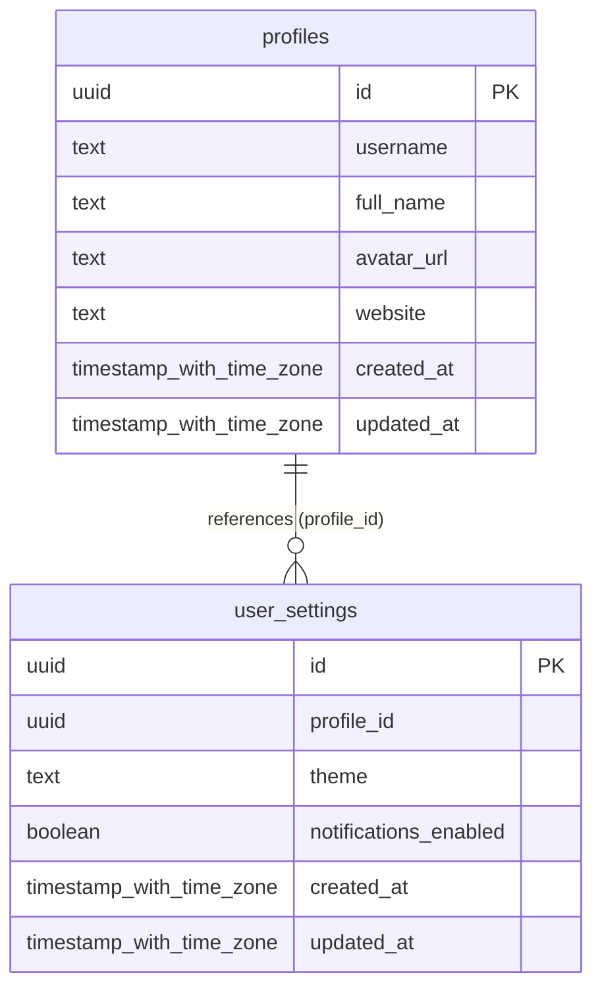

# Database Schema Documentation

> Auto-generated from database schema on `2026-10-19 16:52:06 UTC`.

## Entity Relationship Diagram

---

## Tables Directory

### `profiles`

| Column | Type | Nullable | Default | Key |
|---|---|---|---|---|
| `id` | `uuid` | NO | `gen_random_uuid()` | PRIMARY KEY |
| `username` | `text` | YES | - | - |
| `full_name` | `text` | YES | - | - |
| `avatar_url` | `text` | YES | - | - |
| `website` | `text` | YES | - | - |
| `created_at` | `timestamp with time zone` | NO | `now()` | - |
| `updated_at` | `timestamp with time zone` | NO | `now()` | - |

### `user_settings`

| Column | Type | Nullable | Default | Key |
|---|---|---|---|---|
| `id` | `uuid` | NO | `gen_random_uuid()` | PRIMARY KEY |
| `profile_id` | `uuid` | NO | - | - |
| `theme` | `text` | NO | `'system'::text` | - |
| `notifications_enabled` | `boolean` | NO | `true` | - |
| `created_at` | `timestamp with time zone` | NO | `now()` | - |
| `updated_at` | `timestamp with time zone` | NO | `now()` | - |

